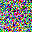
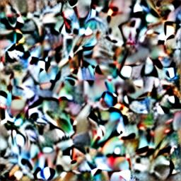
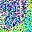
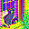

ページ：[01](01_quickstart.md) | [02](02_overview.md) | [03](03_clip.md) | [04](04_conv2d.md) | [05](05_groupnorm.md) | [06](06_resblock.md) | [07](07_unet.md) | [08](08_cross_attention.md) | [09](09_ddim.md) | **10** | [11](11_pipeline.md) | [12](12_lora.md) | [13](13_architecture.md)

---

# VAE Decoder: 潜在空間から画像へ

デノイジングが完了した潜在表現 `(4, 32, 32)` を、人間が見られるピクセル画像 `(3, 256, 256)` に変換するのが **VAE Decoder** です。

VAE (Variational AutoEncoder) は、画像を小さな潜在表現に圧縮する **Encoder** と、潜在表現から画像を復元する **Decoder** の対になったモデルです。テキストから画像を生成する場合、潜在表現はノイズから作られるため Encoder の出番はなく、使うのは Decoder だけです（Encoder は、既存の画像を出発点にする img2img などで使われます）。

1. テキスト
   - [CLIP Text Encoder](03_clip.md)
2. 条件ベクトル
3. ランダムノイズ
   - U-Net × 10 step
     - [Conv2D](04_conv2d.md)
     - [GroupNorm](05_groupnorm.md)
     - [ResBlock](06_resblock.md)
     - [Cross-Attention](08_cross_attention.md)
4. 潜在表現
   - **VAE Decoder** ← この章
5. 画像

## 1. なぜ潜在空間で処理するのか

SD 1.5 は (3, 256, 256) のピクセル画像を直接扱わず、(4, 32, 32) の**潜在表現**で処理します。

| | ピクセル空間 | 潜在空間 |
|---|---|---|
| サイズ | (3, 256, 256) | (4, 32, 32) |
| 要素数 | 196,608 | 4,096 |
| 圧縮率 | 1× | **48 倍圧縮** |

U-Net のデノイジングはステップごとに全パラメータを使った推論を行うため、48 倍の圧縮は計算コストに直結します。潜在空間での処理により、画質をほぼ維持しながら大幅に高速化できます。

48 分の 1 に減らしても画質が保てるのは、画像に冗長性が多いからです。隣り合うピクセルは似た色であることが多く、毛並みや木目のような質感は「こういう質感」という情報さえあれば再現できます。JPEG が画像を大幅に圧縮できるのと同じ事情です。VAE はこの冗長な部分の描き方を重みとして覚えており、潜在表現には「どこに何があるか」という要点だけを残します。

この分業により、U-Net は構図や内容の決定に専念し、ピクセル単位の細かな質感の描画は VAE Decoder に任せることができます。

## 2. 潜在表現 vs ピクセル画像

デノイジング過程の各ステップで、潜在表現とピクセル画像を比較してみましょう。

| ステップ | Latent（4ch を加法混色で表示） | VAE デコード |
|----------|--------------------------|-------------|
| 0 |  |  |
| 5 |  |  |
| 10 |  |  |

左列の Latent は 4 成分を赤・緑・青・シアンに割り当てた加法混色で表示したものです。4 つのチャネルは RGB のような色ではないため色合いに意味はありませんが、ステップ 10 では右列の画像の構図に対応した模様が読み取れます。潜在表現は画像の空間的な配置を保っており、潜在表現の 1 マスが画像の 8×8 ピクセルの領域におおよそ対応しています。

VAE Decoder を通すと（右列）、はっきりした画像が現れます。VAE Decoder は、圧縮ファイルを展開するソフトのように、「1 マスあたり 4 つの数値」という要約を 8×8 ピクセルの絵に描き起こす役割を果たしています。

全ステップの可視化は「[デノイジングステップの可視化](../steps/README.md)」を参照してください。

## 3. VAE Decoder の構造

VAE Decoder は、U-Net の後半（上り）だけを取り出したような構造です。ResBlock（👉[06](06_resblock.md)）とアップサンプリング（👉[07](07_unet.md)）という、すでに見た部品が中心です。スキップ接続やタイムステップ、テキスト条件はなく、Attention も Mid block に 1 つあるだけです（4 節）。

```
潜在表現 (4, 32, 32)
  ↓ post_quant_conv (1×1)
  ↓ conv_in (3×3)
(512, 32, 32)
  ↓ Mid block: ResBlock → Attention → ResBlock
(512, 32, 32)
  ↓ Up block 0: ResBlock×3 → upsample
(512, 64, 64)
  ↓ Up block 1: ResBlock×3 → upsample
(512, 128, 128)
  ↓ Up block 2: ResBlock×3 (512→256) → upsample
(256, 256, 256)
  ↓ Up block 3: ResBlock×3 (256→128)
(128, 256, 256)
  ↓ GroupNorm → SiLU → conv_out (3×3)
画像 (3, 256, 256)
```

空間サイズが 32→64→128→256 と拡大されます。4 つの Up block のうち最初の 3 つでアップサンプリングし、最後のブロックはアップサンプルなしのため、$2^3 = 8$ 倍になります。

U-Net の下りとは逆に、空間サイズが大きくなるにつれてチャネル数が 512 → 256 → 128 と減っていきます。最後の conv_out で 3 チャネル（RGB）にまとめられて画像になります。

## 4. VaeAttention

VAE Decoder の Mid block には **VaeAttention** が 1 つだけ含まれています。U-Net の CrossAttention と異なり、**単一ヘッド**の Self-Attention です。

```python
class VaeAttention:
    def __call__(self, x):
        C, H, W = x.shape
        h = group_norm(x, ...)
        h = h.reshape(C, H * W).T        # (H*W, C)
        q = linear(h, ...)
        k = linear(h, ...)
        v = linear(h, ...)
        attn = softmax(q @ k.T / (C ** 0.5))  # 単一ヘッド
        h = attn @ v
        h = linear(h, ...)
        h = h.T.reshape(C, H, W)
        return x + h                      # 残差接続
```

| | VaeAttention | U-Net CrossAttention |
|---|---|---|
| ヘッド数 | 1 | 8 |
| 外部条件 | なし（Self-Attention のみ） | テキスト埋め込み |
| スケール | $1/\sqrt{C}$ | $1/\sqrt{d_{head}}$ |

VaeAttention は空間方向の Self-Attention で、潜在表現の各ピクセル間の関係を捉えます。SpatialTransformer（👉[08](08_cross_attention.md)）と同じ `reshape(C, H*W).T` による 2D→系列変換を使います。

## 5. スケーリング係数

VAE Decoder に渡す前に、潜在表現を定数 **0.18215** で割ります。

```python
decoded = model.vae(latents / 0.18215)
```

この値は、潜在表現のスケールを調整するために導入されたスケーリング係数です。学習済みモデルに固有の定数であり、SD 1.5 では常にこの値を使います。

なぜ必要なのでしょうか。拡散過程は「信号」と「標準偏差 1 のノイズ」を混ぜる仕組みなので（👉[09](09_ddim.md)）、信号の側も標準偏差が 1 程度に揃っているのが好都合です。ところが VAE が出力する本来の潜在表現は、それより数倍大きなスケールを持っています。そこで U-Net の学習時には潜在表現に 0.18215 を掛けて標準偏差をおよそ 1 に揃えており、U-Net が扱う潜在表現はすべてこの縮小されたスケールになっています。

VAE Decoder に渡すときは、0.18215 で割って本来のスケールに戻します。割るのを忘れると、振幅が約 1/5.5 の入力を渡すことになり、正しい画像になりません。

```
スケーリングあり: mean=-0.1075, std=0.7511
スケーリングなし: mean=-0.1623, std=0.1132
スケーリングにより入力の振幅が 5.5 倍に拡大
```

乱数の潜在表現をデコードした例です。スケーリングなしでは出力の標準偏差が 0.11 しかなく、明暗の差に乏しい出力になっています。

## 6. TAESD: 軽量 VAE デコーダー

[TAESD (Tiny AutoEncoder for Stable Diffusion)](https://huggingface.co/madebyollin/taesd) は、SD 1.5 の VAE Decoder を蒸留（distillation）で軽量化したモデルです。蒸留とは、大きなモデル（教師）の出力を、小さなモデル（生徒）が真似るように学習させる手法です。TAESD は同じ潜在表現から VAE とほぼ同じ画像を出力するよう学習されているため、VAE Decoder とそのまま差し替えて使えます。

### 構造の比較

| | VAE Decoder | TAESD Decoder |
|---|---|---|
| パラメータ数 | 約 4,900 万 | 約 120 万（**約 1/40**） |
| ファイルサイズ | 160 MB (fp16) | 9.4 MB (fp32) |
| チャネル数 | 512→256→128 | **64 固定** |
| Attention | あり（Mid block） | **なし** |
| GroupNorm | あり | **なし** |
| 活性化関数 | SiLU | **ReLU** |
| 基本構成 | ResBlock + Attention | **Conv + ReLU のみ** |

なお、パラメータ数は Decoder 単体の値ですが、ファイルサイズは Encoder を含む VAE 全体（TAESD も Encoder 込み）の値です。

TAESD は `nn.Sequential` に 19 層がフラットに格納されたシンプルな構造で、Conv2D と ReLU だけで構成されています。Attention や GroupNorm を排除することで、パラメータ数とデコード時間の両方を大幅に削減しています。

VAE Decoder と同じく 3 回のアップサンプリングで空間サイズを 8 倍に拡大しますが、チャネル数は全層 64 固定で、Attention や GroupNorm は一切使いません。この単純さが軽量化の鍵です。

### 実装の比較

使う基本演算（`conv2d`、`upsample_nearest_2d`）は VAE Decoder と同じですが、構成要素が大幅に削減されています。

**入力の前処理**: VAE Decoder は `post_quant_conv`（1×1 Conv）で入力を変換しますが、TAESD にはこの層がありません。代わりに、入力の潜在表現を `clamp(-3, 3)` で範囲制限します。これがないと極端な値が後続の ReLU で飽和し、黒い影のような欠損が生じます。

```python
# VaeDecoder: 1×1 Conv で入力を変換
x = conv2d(x, post_quant_conv_weight, post_quant_conv_bias)

# TaesdDecoder: clamp で範囲制限
x = x.clamp(-3, 3)
```

**ResBlock**: VAE では GroupNorm → SiLU → Conv を 2 回重ね、skip 後の活性化はありません。TAESD では Conv → ReLU を 3 回重ね、skip 後に ReLU を適用します。

```python
# VaeResBlock
h = silu(group_norm(x, ...))
h = conv2d(h, ...)
h = silu(group_norm(h, ...))
h = conv2d(h, ...)
return x + h

# TaesdResBlock
h = relu(conv2d(x, ...))
h = relu(conv2d(h, ...))
h = conv2d(h, ...)
return relu(h + x)
```

**アップサンプル**: VAE ではアップサンプル後に bias 付き Conv を通しますが、TAESD では **bias なし**の Conv です。

```python
# VaeDecoder
x = upsample_nearest_2d(x, 2)
x = conv2d(x, weight, bias, padding=1)

# TaesdDecoder
x = upsample_nearest_2d(x, 2)
x = conv2d(x, weight, padding=1)  # bias なし
```

**出力のスケーリング**: VAE Decoder は `[-1, 1]` 範囲の値を出力しますが、TAESD は `[0, 1]` 範囲で出力するため、後段で変換します。

```python
# VaeDecoder: そのまま [-1, 1] を出力
x = silu(group_norm(x, ...))
x = conv2d(x, ...)
return x

# TaesdDecoder: [0, 1] → [-1, 1] に変換
x = conv2d(x, ...)
return x * 2 - 1
```

**不要になった演算**: TAESD では `group_norm`、`silu`、`linear`、`softmax` が一切使われません。Attention（`linear` + `softmax`）と正規化（`group_norm`）の除去が、軽量化の最大の要因です。

## 実験：VAE Decoder の動作確認

VAE Decoder の入出力形状や圧縮率など、本文中の数値を確認するためのスクリプトです。スケーリング係数の効果は本文中で引用しています。

**実行方法**: ([10_vae.py](10_vae.py))

```bash
uv run docs/10_vae.py
```

```
=== 1. VAE Decoder の入出力 ===
入力（潜在表現）: (4, 32, 32)
スケーリング後:   (4, 32, 32)
出力（画像）:     (3, 256, 256)
空間の拡大: 32×32 → 256×256 (×8)
チャネル:   4 → 3

=== 2. 圧縮率 ===
ピクセル空間: 196,608 要素
潜在空間:     4,096 要素
圧縮率:       48×

=== 5. 画像への変換 ===
PIL Image: size=(256, 256), mode=RGB
値の範囲: decoded [-1.93, 1.65] → pixel [0, 255]
```

VAE Decoder の出力はおおむね [-1, 1] の範囲の実数で、これを [0, 255] の整数に変換して画像ファイルにします。この例のように範囲を少しはみ出す値もあるため、変換時に切り詰めます。入力が乱数のため、値は実行ごとに多少変わります。

---

ページ：[01](01_quickstart.md) | [02](02_overview.md) | [03](03_clip.md) | [04](04_conv2d.md) | [05](05_groupnorm.md) | [06](06_resblock.md) | [07](07_unet.md) | [08](08_cross_attention.md) | [09](09_ddim.md) | **10** | [11](11_pipeline.md) | [12](12_lora.md) | [13](13_architecture.md)
