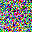
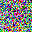
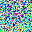
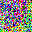
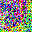
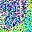
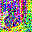
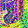
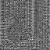
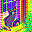

ページ：[01](01_quickstart.md) | [02](02_overview.md) | [03](03_clip.md) | [04](04_conv2d.md) | [05](05_groupnorm.md) | [06](06_resblock.md) | [07](07_unet.md) | [08](08_cross_attention.md) | [09](09_ddim.md) | [10](10_vae.md) | **11** | [12](12_lora.md) | [13](13_architecture.md)

---

# パイプライン統合: テキストから画像へ

これまでの章で個別に学んだコンポーネントが、パイプラインとしてどのように組み合わさるかを見ていきます。中心となるのは **Classifier-Free Guidance (CFG)** という仕組みです。

1. テキスト
   - [CLIP Text Encoder](03_clip.md)
2. 条件ベクトル
3. ランダムノイズ
   - [U-Net](07_unet.md) × 10 step
   - [DDIM Scheduler](09_ddim.md)
4. 潜在表現
   - [VAE Decoder](10_vae.md)
5. 画像
   - **パイプライン統合** ← この章

## 1. パイプライン全体のコード

`model.py` の `generate()` メソッドが全体の流れを実装しています。

```python
def generate(self, prompt, negative_prompt="", seed=None, steps=10,
             cfg_scale=7.5, height=256, width=256):
    self.scheduler.set_timesteps(steps)

    # 1. テキストを条件ベクトルに変換
    cond_emb = self.text_encoder(self.tokenizer.encode(prompt))
    uncond_emb = self.text_encoder(self.tokenizer.encode(negative_prompt))

    # 2. ランダムノイズ生成
    generator = torch.manual_seed(seed) if seed is not None else None
    latents = torch.randn(4, height // 8, width // 8, generator=generator)

    # 3. デノイジングループ
    with torch.no_grad():
        for t in self.scheduler.timesteps:
            t_int = int(t)
            noise_cond = self.unet(latents, t_int, cond_emb)
            noise_uncond = self.unet(latents, t_int, uncond_emb)
            noise_pred = noise_uncond + cfg_scale * (noise_cond - noise_uncond)
            latents = self.scheduler.step(noise_pred, t_int, latents)

    # 4. VAE デコード
    return decode_to_image(self.vae(latents / 0.18215))
```

わずか 20 行足らずのコードで、テキストから画像が生成されます。各行がどの章に対応するかを整理します。

| 処理 | 内容 | 章 |
|---|---|---|
| `text_encoder(...)` | プロンプトを (77, 768) の条件ベクトルに | 👉[03](03_clip.md) |
| `torch.randn(...)` | シードから初期ノイズを生成 | |
| `self.unet(...)` | ノイズを予測 | 👉[07](07_unet.md) |
| `scheduler.step(...)` | 予測を使ってノイズを一段階除去 | 👉[09](09_ddim.md) |
| `self.vae(...)` | 潜在表現を画像に変換 | 👉[10](10_vae.md) |

まだ説明していないのは、デノイジングループの中で U-Net を 2 回呼び、その結果を組み合わせている部分だけです。

## 2. Classifier-Free Guidance (CFG)

パイプラインの核心は、デノイジングループ内の 3 行です。

```python
noise_cond = self.unet(latents, t_int, cond_emb)      # 条件付きノイズ予測
noise_uncond = self.unet(latents, t_int, uncond_emb)   # 無条件ノイズ予測
noise_pred = noise_uncond + cfg_scale * (noise_cond - noise_uncond)
```

U-Net を **2 回** 実行します。

1. **条件付き** (`cond_emb`): 「a cat sitting on a windowsill」を条件にしたノイズ予測
2. **無条件** (`uncond_emb`): 空文字列を条件にしたノイズ予測（テキスト条件なし）

そして、2 つの予測の**差分を増幅**して最終的なノイズ予測とします。

$$\epsilon_{final} = \epsilon_{uncond} + s \cdot (\epsilon_{cond} - \epsilon_{uncond})$$

ここで $s$ は `cfg_scale` です。

### CFG の直感

2 つの予測の違いは、テキスト条件の有無だけです。したがって差分 $\epsilon_{cond} - \epsilon_{uncond}$ は、「プロンプトがあることで予測がどう変わったか」、つまり**プロンプトの効き目だけを取り出したもの**と言えます。

CFG は、無条件の予測を出発点として、この差分の方向へ $s$ 倍だけ進みます。

```
ε_uncond              ε_cond                                    ε_final
   ●───────────────────→●─ ─ ─ ─ ─ ─ ─ ─ ─ ─ ─ ─ ─ ─ ─ ─ ─ ─ ─ ─→●
   │←── 差分（s=1）───→│
   │←───────────── 差分を s 倍に延長（s=7.5）──────────────────→│
```

条件付きの予測 $\epsilon_{cond}$ で止まらず、同じ方向にさらに行き過ぎるのがポイントです。「プロンプトなしならこう、ありならこう変わる。ならば、その変化をもっと強調しよう」という発想です。似顔絵で特徴を誇張するのに似ています。

なぜ誇張が必要なのでしょうか。$\epsilon_{cond}$ をそのまま使うと（$s = 1.0$）、プロンプトに一応は沿っているものの、どっちつかずでぼんやりした画像になりがちです（👉[01](01_quickstart.md) の cfg=1.0 の画像）。差分を増幅することで、プロンプトの内容がはっきり現れた画像になります。ただし増幅しすぎると、コントラストが強すぎる不自然な画像になります。

$s$ の値による違いをまとめます。

| $s$ | $\epsilon_{final}$ | 効果 |
|---:|---|---|
| 0.0 | $\epsilon_{uncond}$ そのもの | プロンプトは完全に無視される |
| 1.0 | $\epsilon_{cond}$ そのもの | ガイダンスなし。無条件側は結果に影響しない |
| 7.5 | 差分を 7.5 倍に増幅 | デフォルト |
| 15.0 | 差分を 15 倍に増幅 | プロンプトに強く従う |

$s = 1.0$ のときは式全体が $\epsilon_{cond}$ になるため、無条件側の予測は結果に影響しません。この場合は無条件側の U-Net 呼び出しが不要になり、ステップあたりの計算量が半分になります。

GPT-2 の temperature が「確率分布の鋭さ」を制御したのと対照的に、CFG は「条件付けの強さ」を制御します。

## 3. Negative Prompt

`uncond_emb` に空文字列の代わりにテキストを入れると、**Negative Prompt** になります。

```python
uncond_emb = self.text_encoder(self.tokenizer.encode(negative_prompt))
```

例えば `negative_prompt="blurry, low quality"` とすると、「ぼやけた低品質な画像」に向かうノイズ予測が `uncond_emb` 側になります。

CFG は「出発点から条件付きの予測へ向かう方向」に進む仕組みでした。出発点を「何もなし」から「ぼやけた低品質な画像」に置き換えると、進む方向は「ぼやけた低品質な画像から、プロンプトの画像へ」となります。プロンプトに近づくと同時に、Negative Prompt の内容から**遠ざかる**効果が生まれるわけです。

```
通常:             （条件なし）        →  プロンプト  →→→ さらに先へ
Negative Prompt:  blurry, low quality →  プロンプト  →→→ さらに先へ
```

つまり Negative Prompt は特別な仕組みではなく、CFG の「無条件」側にテキストを入れるだけです。前述のとおり $s = 1.0$ では無条件側が結果に影響しないため、Negative Prompt が意味を持つのは `cfg_scale > 1.0` のときに限られます。

## 4. デノイジング過程の可視化

10 ステップのデノイジング過程で、潜在表現と画像がどう変化するかを見ましょう。02 章では一部だけを示しましたが、ここでは全ステップを並べます。ステップ 0 が初期ノイズ、ステップ 10 が最終結果です。

| ステップ | Latent | VAE デコード |
|----------|--------|-------------|
| 0 |  |  |
| 1 |  |  |
| 2 |  |  |
| 3 |  |  |
| 4 |  |  |
| 5 |  |  |
| 6 |  |  |
| 7 |  |  |
| 8 |  |  |
| 9 |  |  |
| 10 |  |  |

初期ステップ（0〜3）では全体の構図やシルエットが形成され、後半ステップ（4〜10）では細部のディテールが追加されていきます。Latent 列を見ると、ノイズが徐々に構造化されていく過程が分かります。

## 5. 各ステップの計算コスト

1 ステップあたり U-Net を 2 回実行するため、10 ステップでは合計 20 回の U-Net 推論が必要です。U-Net は約 860M パラメータあるため、パイプライン全体の計算コストのほとんどを占めます。

| コンポーネント | 実行回数 | パラメータ数 |
|---|---|---|
| CLIP Text Encoder | 2（条件+無条件） | ~123M |
| U-Net | 20（10 ステップ × 2） | ~860M |
| VAE Decoder | 1 | ~50M |

生成を速くしたければ、U-Net の実行回数を減らすのが最も効果的だと分かります。次章の LCM LoRA（👉[12](12_lora.md)）は、ステップ数を 2〜4 に減らし、さらに CFG を不要にして 1 ステップあたりの実行を 1 回にすることで、まさにこの回数を削減します。

## 実験：パイプラインの各段階を追跡

パイプラインの各ステップの中間テンソルや CFG スケールの効果を確認します。

**実行方法**: ([11_pipeline.py](11_pipeline.py))

```bash
uv run docs/11_pipeline.py
```

```
=== 2. デノイジングの追跡 ===
初期 latents: mean=0.0009, std=1.0074
  Step 0 (t=900):
    guidance の大きさ: 0.0208
    latents: mean=0.0030, std=0.9955
  Step 4 (t=500):
    guidance の大きさ: 0.0109
    latents: mean=0.0272, std=0.9764
  Step 9 (t=0):
    guidance の大きさ: 0.0103
    latents: mean=0.0449, std=0.9664
```

「guidance の大きさ」は差分 $\epsilon_{cond} - \epsilon_{uncond}$ の平均絶対値です。U-Net が予測する対象は標準偏差 1 のノイズですから、それに比べるとプロンプトの有無による違いは数 % 程度のわずかなものです。CFG がこの小さな差を 7.5 倍に増幅する理由が、数値からも読み取れます。

latents の標準偏差は、最初から最後までほぼ 1 のまま保たれています。ノイズが画像に置き換わっていくだけで、全体のスケールは変わりません（👉[09](09_ddim.md)、[10](10_vae.md) のスケーリング係数）。

---

ページ：[01](01_quickstart.md) | [02](02_overview.md) | [03](03_clip.md) | [04](04_conv2d.md) | [05](05_groupnorm.md) | [06](06_resblock.md) | [07](07_unet.md) | [08](08_cross_attention.md) | [09](09_ddim.md) | [10](10_vae.md) | **11** | [12](12_lora.md) | [13](13_architecture.md)
